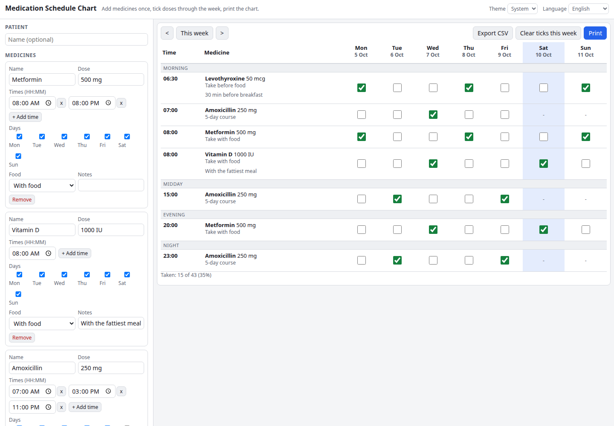

# Medication Schedule Chart

A printable weekly medication chart. Add each medicine once with its dose, times, days of the week and food rule, then tick doses off on a weekly grid or print a clean A4 landscape sheet with empty boxes to tick by hand.

**Try it: [hermes98761234.github.io/medication-schedule-chart](https://hermes98761234.github.io/medication-schedule-chart/)**

[](https://github.com/hermes98761234/medication-schedule-chart/actions/workflows/deploy.yml)



## Features

- **Medicines with several times a day**, chosen weekdays, with / before / after food and free notes.
- **Weekly grid** grouped into morning, midday, evening and night, with today highlighted and week navigation.
- **Checkboxes per dose** and a taken / due summary for the week.
- **Print layout** for A4 landscape: controls hidden, large tick boxes, patient name and week in the header.
- **Export** to CSV (a week's status) or JSON (full backup, importable).
- **English and Ukrainian, light, dark or system theme.** Everything is saved in localStorage and never leaves your browser.

## How it works

Each medicine expands into one row per time of day; rows are sorted by time. A dose is identified by `date|medicine|time`, so ticks stay attached to the right week. This is a memory aid, not medical advice.

## Quick start

You need [Node.js](https://nodejs.org/) 22.

```bash
npm install
npm run dev       # http://localhost:5173
npm test          # unit tests for the schedule logic
npm run build     # static site in dist/
```

## License

MIT
